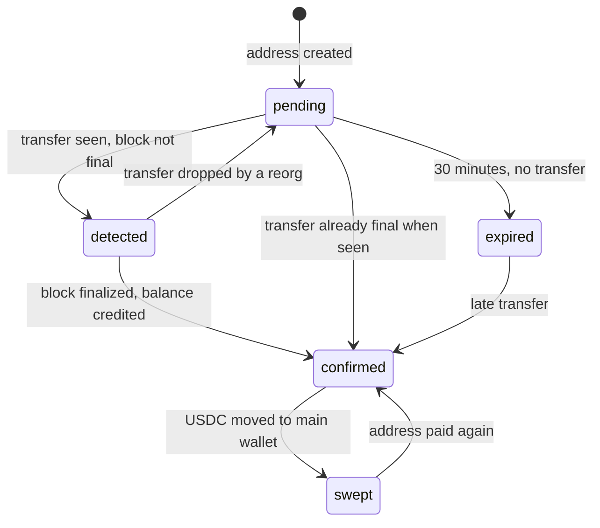

# Crypto Balance System

A USDC balance system on the Polygon network. Users can sign up, top up their balance by sending USDC to a one-time deposit address, and withdraw to any Polygon address. The server watches the chain, credits deposits once their block is finalized, sweeps the funds into the app's main wallet, and can process withdrawals from it.

## Tech stack

| Area | Technology | Used for |
| --- | --- | --- |
| Framework | Next.js 16, React 19, TypeScript | App Router pages and route handlers |
| Styling | Tailwind CSS 4 | UI |
| Database | PostgreSQL, Prisma 7 (`@prisma/adapter-pg`) | Users, deposits, withdrawals, ledger |
| Auth | NextAuth, bcrypt | Credentials login, JWT sessions, password hashing |
| Blockchain | viem | Polygon RPC calls, HD wallet derivation, USDC transfers |

## How it works

### Deposits

1. The user enters an amount (minimum of 1 USDC). The server then derives a new address from a HD wallet (`DEPOSIT_MNEMONIC`, next index from a global counter) and gives it 30 minutes to be paid. If the user already has an unexpired pending address, it is reused to save on addresses.
2. The deposit page shows a QR code, the address, the amount and a countdown, and polls the deposit's status every second.
3. **Detection** (`/api/cron/process-deposits`) reads USDC `Transfer` logs sent to watched addresses, up to 2,000 blocks per run from where the last run stopped.
   - A transfer in a block that is not finalized yet marks the deposit `detected`.
   - Once the block is finalized, the balance is credited with the amount actually received. Each transfer is credited once, keyed on `(txHash, logIndex)`.
   - Transfers under 1 USDC are ignored. An address stays watched for 3 days after it expires, so late or repeated payments are still credited.
4. **Sweep** (`/api/cron/sweep-deposits`) moves the USDC from each credited deposit address to the main wallet. If the address doesn't hold enough POL for gas, the main wallet sends it the exact estimated amount first.

### Withdrawals

The user enters an amount (minimum 1 USDC) and a destination address. A 2% fee is taken: the balance is debited the full amount, the destination receives the rest, and the fee goes to the profit wallet. If the transfer can't be sent or reverts on chain, the withdrawal is marked `failed` and the balance is refunded in the same database transaction.

### Ledger

The finance page shows the current balance and the 50 most recent ledger entries (swept deposits and completed withdrawals).

## Design notes

- **No floating point money.** Amounts are `BigInt` USDC base units (6 decimals) everywhere, stored as Postgres `BIGINT`. User input is parsed from a string with a strict regex.
- **One address per deposit.** Each deposit gets its own derived address, so an incoming transfer maps to a user without memos or amount matching.
- **Only finalized blocks are credited.** A reorg can't credit funds that later disappear. Unfinalized transfers are shown as `detected` so the user still gets feedback.
- **Exactly-once crediting.** Each credited transfer is a `deposit_transfer` row with a unique `(txHash, logIndex)`. The row and the balance increment are written in one transaction, so re-scanning the same blocks credits nothing twice.
- **No overdrafts.** A withdrawal debits the balance with a conditional `UPDATE ... WHERE balance >= amount`, so concurrent withdrawals can't spend the same funds.
- **Row locks in a fixed order.** Deposit creation locks the user row (`SELECT ... FOR UPDATE`); crediting locks the user row before the deposit row, the same order, so the two can't deadlock.
- **Crash-safe sweeps.** A sweep claims a deposit with an atomic compare-and-set on `sweepStartedAt`. A claim older than 5 minutes is assumed crashed and can be taken over. The on-chain balance is checked before sending, so a run that moved the funds but died before saving isn't repeated.
